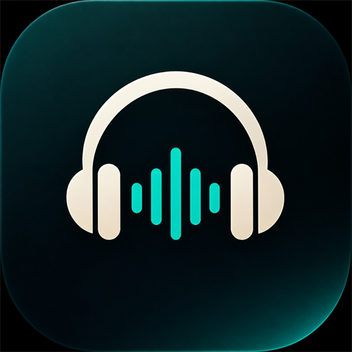

<div align="center">
  
  <h1>SunZara (सुन ज़रा)</h1>
  <p><strong>Your music. Your world.</strong></p>
  <p>
    A hybrid offline &amp; online music player for Android built with Flutter, Riverpod, Drift SQLite,
    <code>just_audio</code>, and native Android audio/speech integrations.
  </p>
  <p>
    
    
    
    
  </p>
</div>

---

## ✨ Key Features

### 🎵 Hybrid Local & Online Music Playback
- **Local Library Discovery**: Scans device storage natively via Android `MediaStore` (`MediaStoreHelper.kt` & `MediaStoreScanner`) and extracts embedded / content-resolver album artwork cleanly.
- **Music-Only Online Search**: Searches strictly within YouTube Music **Songs** (`WEB_REMIX` songs filter) so spoken/non-music videos are filtered out from song search and voice commands.
- **Uninterrupted Streaming Proxy**: Routes online audio streams through a local loopback HTTP proxy (`LocalStreamProxy`) using bounded 512 KB range requests with transient-error retries and progressive `itag=18` prioritization for full-length playback without mid-track stalls or 1-minute cutoffs.
- **Background & Lock Screen Controls**: Integrates `audio_service` and `audio_session` for persistent media notifications, Bluetooth/headphone disconnect handling (`becomingNoisy`), and call/focus interruption management.

### 🎙️ SunZara In-App Voice Command (`सुन ज़रा`)
- **Custom Themed Voice Sheet**: Replaces generic external voice popups with an in-app bottom sheet (`VoiceSearchSheet`) styled in SunZara's palette featuring an animated glowing orb, real-time RMS audio-reactive waveform bars, live partial speech transcription, and **Retry** / **Cancel** actions.
- **Headless Android Speech Recognition**: Uses `android.speech.SpeechRecognizer` with live telemetry streamed over an Android `EventChannel`, falling back cleanly to `RecognizerIntent` if no background `RecognitionService` is registered.

### ❤️ Likes, Playlists & Queue Control
- **One-Tap MiniPlayer Heart**: Like or unlike the active track directly from the persistent `MiniPlayer`, keeping **Favorites** and an auto-managed **Liked Songs** playlist in sync inside SQLite.
- **Intentional Queueing**: Selecting an individual track plays it immediately without appending unsolicited tracks to the queue. Swipe **left or right** on any online search result to append it directly to the queue.
- **Shuffle-Bag Engine**: `ShuffleEngine` uses Fisher-Yates shuffle cycles to avoid back-to-back repeats across full queue rotations, alongside `RepeatMode` (`off`, `all`, `one`) and manual **Play Next / Add to Queue** controls.

### 🎛️ Now Playing Experience & Audio Tools
- **Gesture-Driven UI**: Swipe down on `NowPlayingScreen` to dismiss, swipe horizontally on artwork or the mini-player to skip tracks, and tap artwork to reveal live visualizers.
- **Hardware Equalizer & Bass Boost**: Native 5-band equalizer, presets, and bass boost driven by Android `AudioEffect` APIs (`AudioEffectsHelper.kt`) attached to the active `audioSessionId`.
- **Synced Lyrics & Sleep Timer**: Supports timestamped `.lrc` lyric files (`LyricsParser`) and countdown / **End of Track** sleep timers (`SleepTimerController`).

### 🎨 6 Dual-Mode Themes
Switch presets and Light/Dark mode dynamically from **Settings** (`ThemeController` + `SunZaraThemePalette`):
- **Charcoal Teal** *(Default)*
- **Warm Ivory**
- **Midnight AMOLED**
- **Sunset Amber**
- **Deep Ocean**
- **Emerald Forest**

---

## 🏗️ Project Structure

```text
lib/
├── core/
│   ├── models/          # Song, Album, Artist, Playlist, QueueItem, PlaybackContext
│   ├── services/        # AppVersionService (reads live Android PackageInfo)
│   ├── theme/           # 6 dual-mode presets, AppColors, AppTypography, AppTheme
│   └── widgets/         # SunZaraLogo, SongArtwork, DeterministicArtwork, PlayingEqualizerBars
├── features/
│   ├── audio/           # SunZaraAudioHandler, LocalStreamProxy, YouTubeStreamService, PlaybackController
│   ├── database/        # Drift SQLite schema & queries (AppDatabase)
│   ├── favorites/       # Favorites screen synced with Liked Songs playlist
│   ├── home/            # Greeting, voice/text quick search bar, recently played/added sections
│   ├── library/         # MediaStore scanner, MusicRepository, local library browser
│   ├── navigation/      # Lazy-initialized 5-tab MainNavigationShell + pinned MiniPlayer
│   ├── now_playing/     # NowPlayingScreen, MiniPlayer, VisualizerWidget, EqualizerController, Lyrics & SleepTimer
│   ├── playlists/       # Playlists management + pinned Liked Songs playlist
│   ├── queue/           # QueueManager & Fisher-Yates ShuffleEngine
│   ├── search/          # OnlineSearchScreen, VoiceSearchService, SunZara VoiceSearchSheet
│   └── settings/        # Theme switcher, storage rescan, live version About card
android/
└── app/src/main/
    ├── AndroidManifest.xml
    └── kotlin/com/sunzara/app/sunzara/
        ├── MainActivity.kt       # MediaStore, AudioEffects, VoiceSearch & AppInfo platform channels
        ├── AudioEffectsHelper.kt # Android Equalizer & BassBoost bridge
        └── MediaStoreHelper.kt   # Device audio metadata query helper
test/                             # Unit & widget tests across core, audio, database, queue & search
```

---

## 🛠️ Tech Stack

| Layer | Libraries / APIs |
| --- | --- |
| **UI & State** | Flutter (Material 3), `flutter_riverpod`, `google_fonts` |
| **Audio Playback** | `just_audio`, `audio_service`, `audio_session`, custom `LocalStreamProxy` |
| **Database** | `drift` + `drift_flutter` (local SQLite persistence) |
| **Online Music Search** | Direct YouTube Music `WEB_REMIX` endpoint + `youtube_explode_dart` *(no API key needed)* |
| **Native Android** | Kotlin `MethodChannel` / `EventChannel` (`MediaStore`, `Equalizer`, `BassBoost`, `SpeechRecognizer`, `PackageManager`) |

---

## 🚀 Getting Started

### Prerequisites
- Flutter SDK (`Dart SDK ^3.14.0`)
- Java 17 + Android SDK (`minSdk = 29` / Android 10+)
- Connected Android device with USB Debugging enabled (or emulator) for deployment

> **Note:** SunZara does **not** require any `.env` files, API keys, or third-party developer credentials to run or build.

### Run Locally & Verify

```bash
# Install packages
flutter pub get

# Static analysis
flutter analyze --no-pub

# Run all unit & widget tests
flutter test --no-pub
```

### Build & Install Release APK

```bash
# Build release APK
flutter build apk --release --no-pub

# Install onto connected Android device
adb install -r build/app/outputs/flutter-apk/app-release.apk
```

---

## 📦 Versioning Policy

SunZara enforces lockstep versioning via [AGENTS.md](AGENTS.md) and [app_version_test.dart](test/core/app_version_test.dart):
- `pubspec.yaml` (`version: X.Y.Z+N`) defines both `versionName` and Android `versionCode`.
- `AppVersionInfo.fallback` in `lib/core/services/app_version_service.dart` stays synced with `pubspec.yaml`.
- Settings reads the installed APK version directly at runtime via Android's `PackageManager`.
