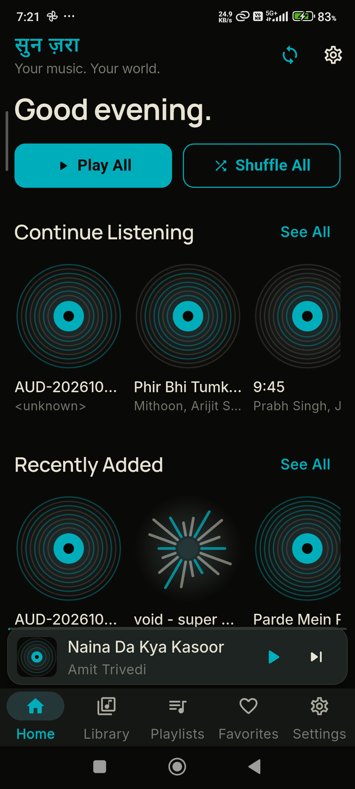

# SunZara

**Your music. Your world.**

SunZara is a Flutter music player for listening to audio stored on your device. It brings your local library, playback controls, playlists, favorites, and listening settings together in one app.



## Features

- Scan device storage and organize local music by songs, albums, artists, folders, and genres.
- Search and sort your library, and browse recently added, recently played, and favorite tracks.
- Play music with a queue, shuffle, repeat, and playback history.
- Create playlists and manage favorites.
- View synchronized lyrics from local LRC files when available.
- Use the equalizer, visualizer, and sleep timer on the now playing screen.
- Switch between light and dark themes.
- Import a Spotify tracks JSON export and match tracks against your local library.

## Getting started

### Requirements

- Flutter SDK (Dart SDK constraint: `^3.14.0`)
- Android Studio or another Android SDK setup for Android builds

### Run the app

1. Clone this repository and open the project folder.
2. Fetch dependencies:

   ```sh
   flutter pub get
   ```

3. Connect an Android device or start an emulator, then run:

   ```sh
   flutter run
   ```

4. Grant the requested audio or media permission so SunZara can scan your music library.

To create an Android release APK:

```sh
flutter build apk --release
```

## Spotify import

SunZara can take a Spotify tracks JSON export or playlist payload from Settings and match its tracks to music already in your local library. It does not stream Spotify tracks.

## Screenshots

| Home and library | Updated player view |
| --- | --- |
|  |  |

## Built with

Flutter and Dart, with Riverpod, just_audio, audio_service, Drift, and Material UI.

## Project structure

- `lib/core` — shared models, theme, and widgets
- `lib/features/audio` — playback state and audio handling
- `lib/features/library` — device scanning and music library
- `lib/features/now_playing` — player screen, lyrics, equalizer, and sleep timer
- `lib/features/database` — local database
- `test/` — unit and widget tests

## License

No license has been added yet. All rights reserved unless the repository owner adds a license.
